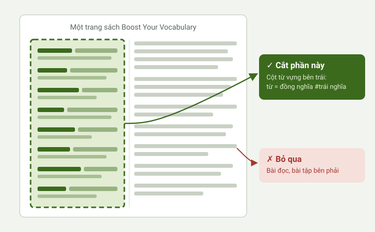

# Sổ Từ Đồng Nghĩa

Ứng dụng web học thuộc từ vựng tiếng Anh theo **từ đồng nghĩa, trái nghĩa, từ loại, phiên âm, nghĩa tiếng Việt và câu ví dụ**, làm riêng cho sách **Boost Your Vocabulary – Cambridge IELTS**.

👉 **Mở ứng dụng:** https://wangling325.github.io/so-tu-dong-nghia/

Ứng dụng miễn phí, không cần tài khoản. Dữ liệu học chỉ lưu trong trình duyệt của bạn.

---

## Cách sử dụng

### Bước 1 · Chuẩn bị sách
Bạn cần cuốn **Boost Your Vocabulary – Cambridge IELTS**. Mỗi bài đọc trong sách có **cột từ vựng ở bên phải** (bên trái là bài đọc, các từ quan trọng được in đậm), ghi theo dạng:

```
từ gốc = từ đồng nghĩa, từ đồng nghĩa #từ trái nghĩa (gốc từ = nghĩa) phiên âm
```

Ví dụ: `reintroduce = bring back, restore, reinstate #eradicate (re- = again)`

### Bước 2 · Chụp và cắt ảnh cột từ vựng
Chụp trang sách (hoặc chụp màn hình bản PDF), rồi **chỉ cắt lấy phần cột từ vựng bên phải**.



Mẹo để ứng dụng đọc đúng:
- Chỉ lấy cột từ vựng, **bỏ ảnh tiêu đề và đoạn bài đọc bên trái**.
- Ảnh **thẳng, đủ sáng, chữ rõ**. Có thể cắt một cột dài thành 2–3 ảnh.
- Giữ cả dòng phiên âm và phần ghi chú gốc từ trong ngoặc.
- Trên Windows: `Win + Shift + S` để chụp nhanh đúng vùng cần cắt.

### Bước 3 · Đưa ảnh vào ứng dụng
Mở ứng dụng, rồi làm **một trong các cách**:
- **Kéo thả** ảnh vào bất cứ đâu trên trang,
- **Dán** ảnh vừa chụp bằng `Ctrl + V`,
- hoặc bấm nút **Thêm từ bằng ảnh**.

Có 3 cách đọc ảnh (chọn trong tab **Bài học**):

| Cách | Độ chính xác | Chi phí |
|---|---|---|
| **OCR miễn phí** (mặc định) | Khá, đôi khi đọc sai vài chữ | Miễn phí |
| **Khóa API Gemini** (*Tự động đọc ảnh bằng khóa API Gemini*), [xem cách lấy khóa](#lấy-khóa-api-gemini-miễn-phí) | Rất tốt, tự sửa lỗi chính tả | Miễn phí, có giới hạn lượt mỗi ngày |
| **Ứng dụng Gemini** (*Đọc bằng ứng dụng Gemini*): sao chép câu lệnh → gửi ảnh trong Gemini → dán kết quả về | Rất tốt | Dùng gói Gemini của bạn |

### Bước 4 · Đợi ứng dụng dịch và thêm ví dụ
Sau khi đọc ảnh, ứng dụng **tự động**:
1. tách từng từ, từ đồng nghĩa (`=`), trái nghĩa (`#`), gốc từ (`( )`),
2. **dịch nghĩa tiếng Việt** và xác định **từ loại** (danh từ, động từ, tính từ…),
3. thêm **phiên âm** cho từ gốc và từng từ đồng nghĩa,
4. thêm **câu ví dụ tiếng Anh kèm câu dịch**,
5. thêm **ảnh minh hoạ cho danh từ** (lấy từ Wikipedia),
6. **lưu thành một bài mới** và mở thẻ ghi nhớ để học ngay.

Thường mất 10–60 giây. Nếu có chữ đọc sai, sửa ở tab **Bài học → Sửa**. Nghĩa tiếng Việt và từ loại sửa trực tiếp được trong tab **Danh sách**.

**Ảnh minh hoạ** (trong tab Danh sách, dưới câu ví dụ):
- Danh từ tự có ảnh. Ảnh chưa đúng thì bấm **Ảnh khác** hoặc **Ẩn ảnh**.
- Với mọi từ (động từ, tính từ…), bấm **+ Thêm ảnh của bạn** để chọn ảnh từ máy, hoặc **kéo thả ảnh** vào ô đó. Ảnh được thu nhỏ và lưu trong trình duyệt; có **Đổi ảnh / Xoá ảnh**. Ảnh của bạn cũng được đưa vào tệp *Sao lưu*.

### Bước 5 · Học từ mới theo danh sách chủ đề
Mỗi lần đưa ảnh vào là một **bài**. Nên đặt tên bài theo unit hoặc chủ đề trong sách (ví dụ *Unit 3 – The environment*) để học theo từng chủ đề. Chọn bài ở ô **Bài đang học**, hoặc chọn **★ Tất cả từ đã lưu** để ôn trộn mọi chủ đề.

| Tab | Dùng để |
|---|---|
| **Danh sách** | Xem toàn bộ từ của bài: đồng nghĩa, trái nghĩa, phiên âm, nghĩa, ví dụ. Bấm vào từ để nghe phát âm. |
| **Thẻ ghi nhớ** | Lật thẻ để nhớ nghĩa; *Nhớ rồi* / *Chưa nhớ* (phím `→` / `←`). |
| **Trắc nghiệm** | Chọn nghĩa, chọn từ, tìm từ trái nghĩa, từ tiếng Việt chọn từ tiếng Anh. |
| **Bài tập đồng nghĩa** | Chọn đủ nhóm đồng nghĩa, tìm từ khác nhóm, phân biệt đồng nghĩa / trái nghĩa, viết từ đồng nghĩa. |
| **Gõ từ** | Nhìn nghĩa, gõ lại từ tiếng Anh. |
| **Ghép cặp** | Nối từ với nghĩa của nó. |
| **Bài học** | Thêm, sửa, xoá bài; sao lưu và khôi phục. |

Ứng dụng nhớ mức độ thuộc của từng từ (0–5) và ưu tiên cho bạn ôn những từ hay quên.

---

## Lấy khóa API Gemini (miễn phí)

Khóa API giúp ứng dụng **tự đọc ảnh bằng Gemini**: chính xác hơn OCR miễn phí, tự sửa lỗi chính tả và viết nghĩa tiếng Việt, từ loại, phiên âm, ví dụ. Bạn chỉ cần một tài khoản Google.

### 1. Tạo khóa
1. Mở **https://aistudio.google.com/apikey** và đăng nhập bằng tài khoản Google.
2. Lần đầu vào, đọc và đồng ý với điều khoản của Google AI Studio.
3. Bấm **Create API key** (Tạo khóa API). Nếu được hỏi chọn dự án, chọn **Create API key in new project** (tạo trong dự án mới).
4. Khóa hiện ra là một dãy ký tự bắt đầu bằng `AIza…`. Bấm **Copy** để sao chép.

> Không cần nhập thẻ thanh toán. Nếu trang yêu cầu bật thanh toán (billing) thì bạn đang ở bước tạo khóa trả phí: bỏ qua và dùng khóa miễn phí.

### 2. Dán khóa vào ứng dụng
1. Mở ứng dụng, vào tab **Bài học**.
2. Mở mục **Tự động đọc ảnh bằng khóa API Gemini**.
3. Dán khóa vào ô **Khóa API Gemini**, bấm **Lưu và kiểm tra**.
4. Thấy dòng *"Đã bật Gemini (…)"* là xong. Ứng dụng tự chọn mô hình **Flash-Lite** (nhiều lượt miễn phí nhất); có thể đổi ở ô **Mô hình**.

Từ đó, mỗi ảnh đưa vào sẽ được Gemini đọc. Nếu Gemini lỗi hoặc hết lượt trong ngày, ứng dụng **tự chuyển sang OCR miễn phí** và báo lý do.

### 3. Giới hạn và lưu ý
- **Giới hạn miễn phí:** Google không công bố con số cố định; mỗi tài khoản xem giới hạn của mình trong AI Studio. Mỗi ảnh dùng 1 lượt. Lượt dùng được đặt lại mỗi ngày.
- **Gói Gemini Pro / Google AI Pro không tăng giới hạn của khóa API.** Muốn dùng gói Pro, chọn cách **Đọc bằng ứng dụng Gemini** (sao chép câu lệnh và dán kết quả).
- **Quyền riêng tư:** ở bản miễn phí, Google có thể dùng nội dung gửi lên để cải thiện sản phẩm. Ảnh cột từ vựng thì không sao, nhưng đừng chụp kèm thông tin cá nhân.
- **Giữ khóa bí mật:** khóa chỉ lưu trong trình duyệt của bạn và chỉ gửi đến Google. Đừng gửi khóa cho người khác hay dán lên mạng. Nếu lỡ lộ, vào lại https://aistudio.google.com/apikey để **xoá khóa cũ và tạo khóa mới**.
- Mỗi trình duyệt / thiết bị lưu khóa riêng: trên điện thoại cần dán khóa thêm một lần.

### 4. Gặp lỗi?
| Thông báo trong ứng dụng | Cách xử lý |
|---|---|
| *khóa API không đúng hoặc đã bị xoá* | Sao chép lại đủ cả khóa (bắt đầu bằng `AIza`), không thừa dấu cách; hoặc tạo khóa mới. |
| *đã hết lượt miễn phí hôm nay hoặc gửi quá nhanh* | Đợi vài phút hoặc sang ngày mai; trong lúc đó ứng dụng dùng OCR miễn phí. |
| *mô hình không còn dùng được* | Bấm **Lưu và kiểm tra** lại để ứng dụng chọn mô hình mới. |
| *không kết nối được Internet* | Kiểm tra mạng rồi thử lại. |

Muốn tắt Gemini: bấm **Tắt Gemini, xoá khóa** trong cùng mục.

## Cài như ứng dụng
- **Máy tính (Edge / Chrome):** bấm nút **Cài đặt ứng dụng** ở đầu trang.
- **Điện thoại:** mở trang, chọn **Thêm vào màn hình chính**.

Sau khi cài, ứng dụng có biểu tượng riêng và vẫn học được khi không có mạng (đọc ảnh và dịch thì cần Internet).

## Dữ liệu
- Bài học và tiến độ **chỉ lưu trong trình duyệt** của bạn, không gửi lên máy chủ nào.
- Dùng **Sao lưu ra tệp** (tab Bài học) để giữ bản dự phòng; kéo tệp `.json` đó vào ứng dụng để khôi phục hoặc chuyển sang máy khác.
- Khóa API Gemini (nếu dùng) chỉ lưu trong trình duyệt của bạn.

## Mã nguồn bên thứ ba
- Phiên âm: CMU Pronouncing Dictionary (Carnegie Mellon University), chuyển sang IPA; gói `cmu-pronouncing-dictionary` (ISC), xem `ipa-dict-LICENSE.txt`.
- Đọc chữ: tesseract.js (Apache-2.0), tải từ jsDelivr khi dùng.
- Dịch: Google Dịch / MyMemory (dịch vụ miễn phí bên ngoài); Gemini API (tuỳ chọn, khóa của người dùng).
- Ảnh minh hoạ cho danh từ: Wikipedia / Wikimedia Commons, hiển thị kèm link tới trang nguồn (giấy phép theo từng ảnh).

*Ứng dụng không chứa nội dung của sách Boost Your Vocabulary – Cambridge IELTS; bạn cần có sách để tự đưa từ vựng vào.*
